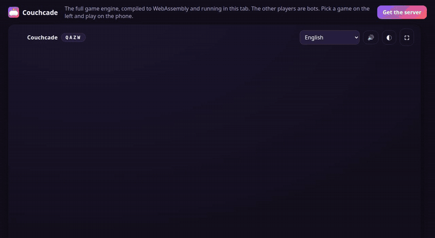

<p align="center"></p>
<h1 align="center">Couchcade</h1>
<p align="center">Juegos de fiesta gratis para una tele y los móviles de todos. Un solo binario de Go, sin cuentas ni app.</p>

<p align="center">
<a href="https://github.com/Arthur031221/Couchcade/actions/workflows/ci.yml"></a>
<a href="LICENSE"></a>
</p>

<p align="center"><a href="README.md">English</a> | <a href="README.zh-TW.md">繁體中文</a> | <a href="README.zh-CN.md">简体中文</a> | <a href="README.ja.md">日本語</a> | <a href="README.ko.md">한국어</a> | <b>Español</b> | <a href="README.fr.md">Français</a> | <a href="README.de.md">Deutsch</a> | <a href="README.pt-BR.md">Português</a></p>

<p align="center"></p>

Abre Couchcade en la tele o en un portátil. Tus amigos escanean el código QR, escriben el código de cuatro letras y juegan desde su móvil. Trae seis juegos originales, un modo público para grupos grandes, bots para cuando falta gente y nueve idiomas con textos escritos para cada uno.

**Pruébalo ahora:** la [demo en línea](https://arthur031221.github.io/Couchcade/) ejecuta el mismo motor compilado a WebAssembly en tu navegador, con bots que ocupan los asientos.

## La cifra

Con 100 móviles simulados (8 sentados y 92 en el público), cada móvil recibió la primera pregunta en menos de 60 ms desde que el anfitrión pulsó Iniciar, en 12 de 12 ejecuciones.

Cómo se midió: `couchcade loadtest -phones 100` arranca un servidor en el mismo proceso, abre 100 conexiones WebSocket reales por loopback, inicia una ronda de Brain Teams desde la conexión del anfitrión y anota cuándo llega a cada móvil el primer mensaje de estado con la pregunta. Se repitió 12 veces en un Ryzen 5 7500F. La difusión osciló entre 37,5 y 48,1 ms porque el servidor agrupa los cambios y los envía cada 50 ms, así que la mayor parte de esa cifra es el intervalo de agrupación. Mide el servidor, no tu Wi-Fi, que añadirá su propio retraso. No se dibuja nada, así que mide la entrega al socket del móvil.

## Antes y después

|  | Un juego de fiesta de pago típico | Couchcade |
| --- | --- | --- |
| Coste | Paquetes de pago | Gratis, licencia MIT |
| Dónde corre | Apps y servidores del editor | Un binario en tu propia red |
| Contenido | Fijado por el editor | Archivos JSON que puedes editar y compartir |
| Idiomas | Según el título | 9, con textos escritos para cada uno |
| Grupos grandes | Depende del juego | 8 jugadores y hasta 500 en el público |

Couchcade no es un clon de ningún juego comercial. Los seis juegos y todos los textos son originales.

## Los juegos

| Juego | Qué haces |
| --- | --- |
| Squiggle | Dibuja el tema en secreto y vota el mejor dibujo |
| Fibber | Escribe una respuesta falsa y descubre la verdadera |
| Brain Teams | Dos equipos compiten con preguntas de opción múltiple |
| Zap | Espera al verde y toca más rápido que nadie |
| Echo | Piensa igual que los demás, las respuestas que coinciden puntúan |
| Mole | Un jugador no tiene la palabra secreta, encuéntralo |

Las reglas y el número de jugadores están en [docs/how-to-play.md](docs/how-to-play.md).

## Inicio rápido

```sh
couchcade serve
```

Abre en la tele la primera dirección que se muestra y escanea el código QR con los móviles. Si tu equipo tiene varias tarjetas de red y el QR apunta a la equivocada, añade `-public-url http://192.168.1.20:8080`.

<details>
<summary>Instalar</summary>

Descarga un binario de la [página de versiones](https://github.com/Arthur031221/Couchcade/releases) o usa:

```sh
# Go 1.24+
go install github.com/Arthur031221/Couchcade/cmd/couchcade@latest

# Docker
docker run --rm -p 8080:8080 ghcr.io/arthur031221/couchcade serve -addr :8080 -public-url http://YOUR-LAN-IP:8080

# Homebrew
brew install Arthur031221/tap/couchcade

# Source
git clone https://github.com/Arthur031221/Couchcade && cd Couchcade
go build -o couchcade ./cmd/couchcade
```

</details>

## Hazlo tuyo

Los textos son JSON normal. Pon tu propio paquete en una carpeta y arranca con `-packs ./my-packs`:

```json
{"id": "office", "lang": "en", "items": {"squiggle": [{"text": "a tired printer"}]}}
```

`couchcade packs validate FILE` revisa un paquete y `couchcade packs stats` cuenta lo que tienes. El formato está en [docs/content-packs.md](docs/content-packs.md), el uso detrás de un proxy en [docs/hosting.md](docs/hosting.md) y el diseño en [docs/architecture.md](docs/architecture.md).

## Qué se prueba

* Pruebas unitarias en Go de la validación de contenido, el motor y cada juego, con el detector de carreras en CI.
* Una prueba de carga con WebSockets reales.
* 13 pruebas de extremo a extremo que manejan Chrome real contra el binario real: cada uno de los seis juegos con una persona y bots, reconexión, expulsar a alguien, más de 8 jugadores, temas claro y oscuro, sin desplazamiento horizontal a 320 px en todos los juegos y los nueve idiomas.
* Una prueba de navegador que juega una partida completa en la demo WebAssembly.

## Límites

* Los móviles y la tele deben alcanzar el servidor, así que lo normal es una sola red Wi-Fi. Jugar por internet requiere un proxy inverso que configures tú.
* Las salas viven en memoria. Reiniciar el servidor termina las partidas en curso.
* No hay inicio de sesión. No expongas el puerto a internet sin un proxy de confianza.
* El dibujo es solo con dedo o ratón, con deshacer y borrar pero sin sensibilidad a la presión.

## Contribuir

Los textos y las traducciones son la entrada más fácil. Mira [CONTRIBUTING.md](CONTRIBUTING.md).

## Licencia

[MIT](LICENSE)

Assisted by Claude/Codex.
